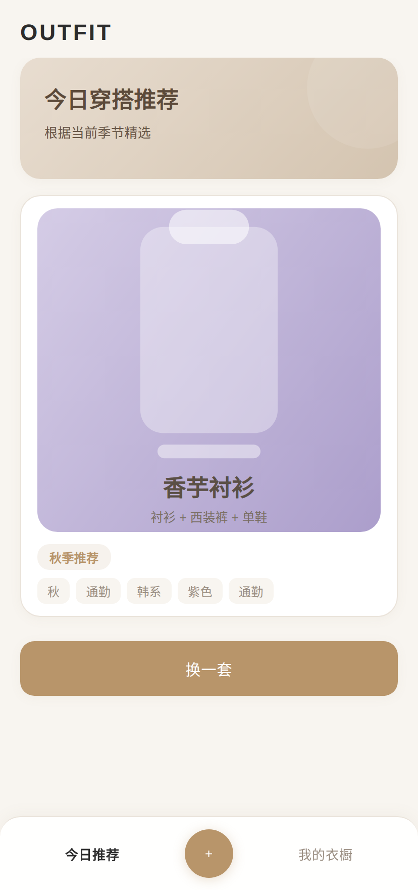
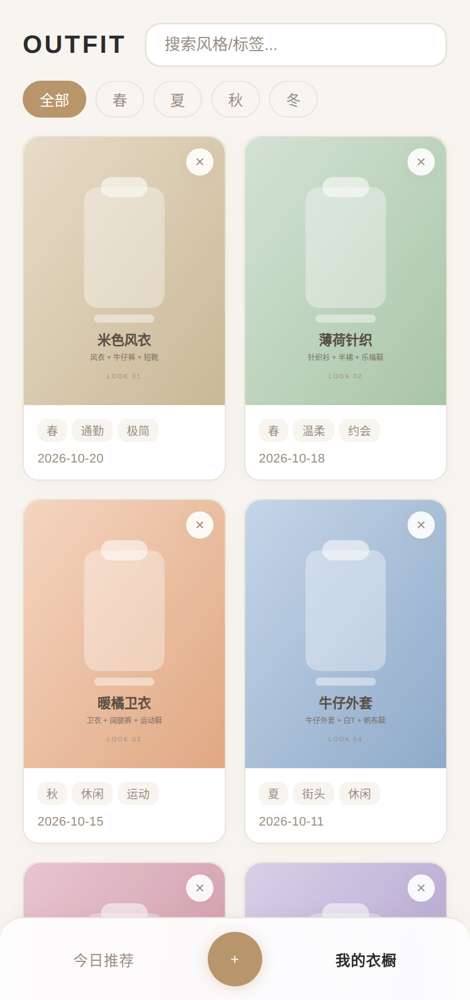
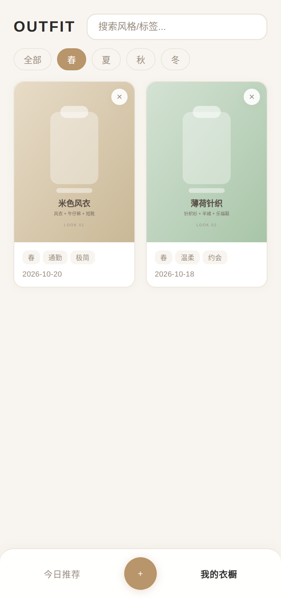
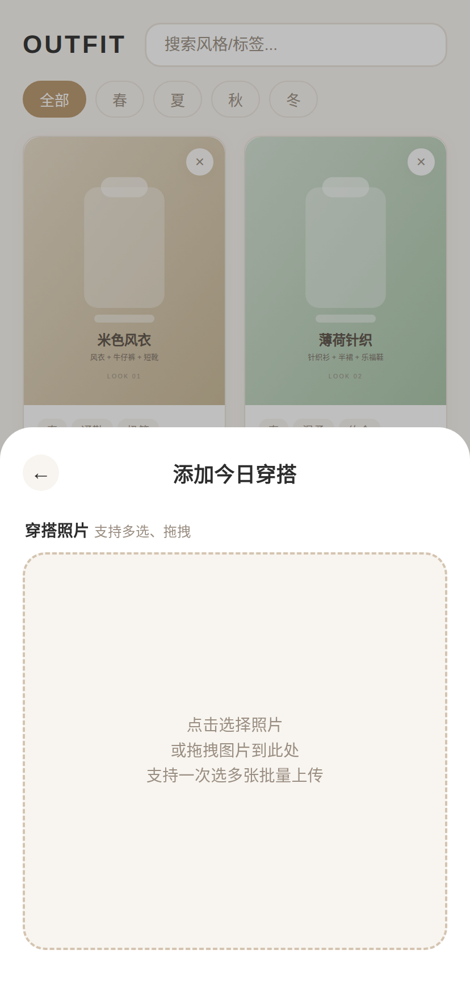

# 穿搭日记

记录每天穿什么的工具。拍照、打标签，之后可以按季节、颜色、风格翻着找。

数据存在自己的数据库里，照片存在自己电脑上，不经过任何第三方服务。

## 功能

- **每日推荐**：按当前季节从衣橱里挑一套穿搭，不知道穿什么时点一下
- **拍照记录**：支持一次选多张，批量上传
- **标签体系**：季节 + 颜色 + 风格，也可以自己加标签
- **筛选搜索**：按季节过滤，按风格/标签关键字搜索
- **手机适配**：页面按手机设计，浏览器里可以「添加到主屏幕」当 App 用

## 界面

| 每日推荐 | 我的衣橱 |
|---|---|
|  |  |

| 季节筛选 | 添加穿搭 |
|---|---|
|  |  |

## 运行

需要 Node.js 和 PostgreSQL，详细步骤见 [部署说明](部署说明.md)。

```bash
npm install
cp .env.example .env   # 填入数据库密码
npm start
```

然后浏览器打开 `http://localhost:3000/outfit.html`。

## 技术构成

前端是单个 HTML 页面，没有构建步骤；后端是 Express + PostgreSQL；照片以文件形式存在本地 `uploads/` 目录，数据库里只存路径。

配置通过 `.env` 文件管理，敏感信息不会进代码库。
